# FinOps HQ

FinOps HQ is a multi-tenant financial operations app for accounting firms and the small businesses they look after. It keeps customers, projects, budgets, invoices, payments and expenses for each client organization, turns them into a dashboard and reports, imports records from QuickBooks Online, and reconciles the two sets of books. Every change to money, permissions or integrations is written to an append-only audit log.

It is a Go API with a React front end on PostgreSQL, built and run natively on Windows: no Docker, no WSL.

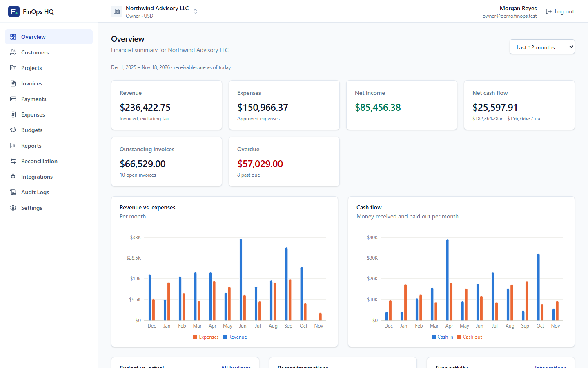

## What it does

- **Organizations and roles.** A user can belong to several organizations with a different role in each (owner, administrator, accountant, project manager, viewer). Permissions are enforced by the API on every request, and PostgreSQL row-level security keeps tenants apart even if a query forgets to.
- **Invoices and payments.** Line items, percentage or fixed discounts, tax, and invoice numbering without gaps. Totals are calculated on the server with exact decimal arithmetic. Payments can be partial, use idempotency keys so a retried request can't pay twice, are serialized per invoice so concurrent payments can't overpay, and are reversed rather than edited.
- **Expenses and budgets.** Expenses are submitted, then approved or rejected. Approvers cannot approve their own submissions; owners are the exception. Projects carry budget lines per category and warn at 80% and above 100%.
- **Dashboard and reports.** Revenue, expenses, net income, cash flow, receivables and overdue amounts, all computed in SQL from the records. Reports cover P&L, revenue, expenses, cash flow, AR aging, outstanding invoices, budget vs. actual and a monthly summary, each with CSV export.
- **QuickBooks Online.** OAuth 2.0 connection, encrypted token storage with refresh and rotation, paged imports with rate-limit handling, and webhooks. Sync runs in background workers backed by a PostgreSQL job table, with retries, exponential backoff, leases and a history of every attempt.
- **Reconciliation.** Imported invoices and payments are compared with the books. Amount and date differences, and records missing on either side, go into a review queue where each decision is recorded and audited.
- **Safe schema changes.** A worked expand → backfill → enforce → contract migration, with a resumable batch backfill and measured lock times.

## QuickBooks: what has and hasn't been verified

The live QuickBooks client (OAuth, token refresh, paged queries, 429/5xx handling, webhook signatures) is implemented against Intuit's documented API and covered by tests that use recorded response shapes. **It has not been run against a real Intuit sandbox company**, because no sandbox credentials were available while building it. Until it has been, treat live mode as untested.

Without credentials the app runs in **simulated mode**. A clearly labelled adapter returns QuickBooks-shaped records derived from the organization's own books, with deliberate discrepancies, so that importing and reconciliation can be tried end to end. The UI marks this mode as "Simulated — sample data" everywhere it matters. See [docs/quickbooks-integration.md](docs/quickbooks-integration.md).

## Tech stack

| Layer | Choice |
|---|---|
| API | Go 1.27, chi router, `log/slog` |
| Database | PostgreSQL 18, pgx v5, sqlc-generated queries, golang-migrate (migrations embedded in the binary) |
| Money | `shopspring/decimal`, `NUMERIC(19,4)` columns |
| Auth | argon2id passwords, server-side sessions in HttpOnly cookies |
| Frontend | React 19, TypeScript, Vite, React Router, TanStack Query, Tailwind CSS 4, Radix primitives, Recharts |
| Tests | Go `testing` against real PostgreSQL, Vitest + Testing Library + MSW, Playwright |

## Getting started on Windows

You need Go, Node.js 20+ and PostgreSQL. [docs/windows-setup.md](docs/windows-setup.md) covers installing them.

```powershell
# 1. Create the database roles, databases and .env (asks for the postgres password once)
powershell -ExecutionPolicy Bypass -File scripts\setup-db.ps1

#    No postgres password? Create a private PostgreSQL instance on port 5433 instead:
#    powershell -ExecutionPolicy Bypass -File scripts\local-postgres.ps1 init

# 2. Apply migrations and load the demo data
cd backend
go run ./cmd/finops migrate up
go run ./cmd/finops seed

# 3. Start the API (it also runs the background sync worker)
go run ./cmd/finops serve

# 4. In a second terminal, start the frontend
cd frontend
npm install
npm run dev
```

Open http://localhost:5173. If your machine blocks IPv6 loopback, run `npx vite --host 127.0.0.1`, open http://127.0.0.1:5173, and set `FRONTEND_ORIGIN=http://127.0.0.1:5173` in `.env`.

### Demo accounts

The seed creates two fictional organizations. Every account uses the password `FinOpsDemo!2026`.

| Email | Role | Organization |
|---|---|---|
| owner@demo.finops.test | Owner | Northwind Advisory LLC (USD) |
| admin@demo.finops.test | Administrator | Northwind Advisory LLC |
| accountant@demo.finops.test | Accountant | Northwind Advisory LLC |
| pm@demo.finops.test | Project Manager | Northwind Advisory LLC |
| viewer@demo.finops.test | Viewer | Northwind Advisory LLC |
| client@demo.finops.test | Owner | Brightline Studio Ltd (GBP) |

The demo data is entirely made up. `seed` refuses to run when `APP_ENV=production`.

## Running the tests

```powershell
powershell -ExecutionPolicy Bypass -File scripts\test-all.ps1        # Go + frontend unit/integration tests, lint, build
powershell -ExecutionPolicy Bypass -File scripts\test-all.ps1 -E2E   # also the Playwright browser tests
```

Go tests run against real PostgreSQL. Each test gets its own throwaway database cloned from a migrated template. The Playwright suite starts its own API on port 8081 with a fresh `finops_e2e` database. Details are in [docs/testing.md](docs/testing.md).

## Project layout

```
backend/
  cmd/finops/         serve | worker | migrate | seed | backfill
  cmd/e2edb/          recreates the Playwright database
  cmd/migrationdemo/  times the vendor schema migration on synthetic data
  db/migrations/      timestamp-versioned SQL migrations (embedded)
  db/queries/         SQL for sqlc
  internal/           one package per domain (invoices, expenses, qbsync, reconcile, ...)
frontend/
  src/pages/          one folder per screen
  e2e/                Playwright workflow tests
docs/                 architecture, schema, API, money rules, migrations, QuickBooks, testing, setup
scripts/              PowerShell helpers (database setup, new migration, tests, e2e server)
```

## Documentation

- [Architecture](docs/architecture.md): how the pieces fit, tenant isolation, background jobs
- [Database schema](docs/database-schema.md): tables, constraints and the guards that protect history
- [API reference](docs/api-reference.md)
- [Financial calculations](docs/financial-calculations.md): rounding, tax, discounts, revenue and cash definitions
- [Database migrations](docs/database-migrations.md): the expand/contract walkthrough, locking and rollback
- [QuickBooks integration](docs/quickbooks-integration.md)
- [Testing](docs/testing.md)
- [Windows setup](docs/windows-setup.md): installation, environment variables and deployment

## Screenshots

| | |
|---|---|
| 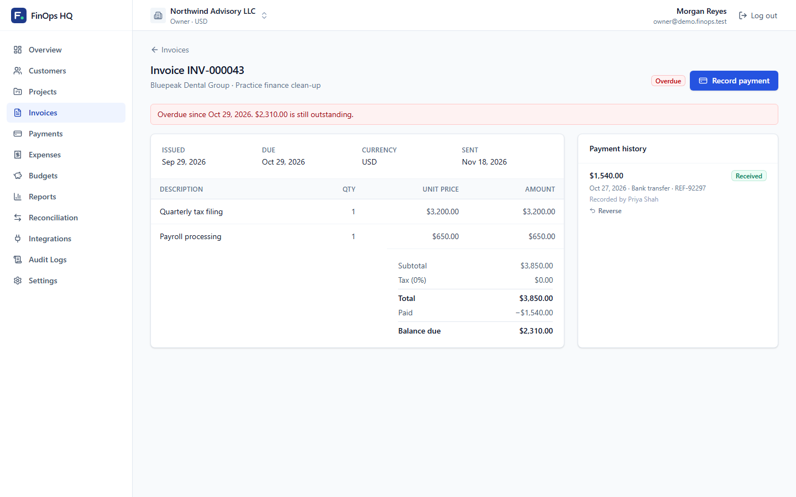 | 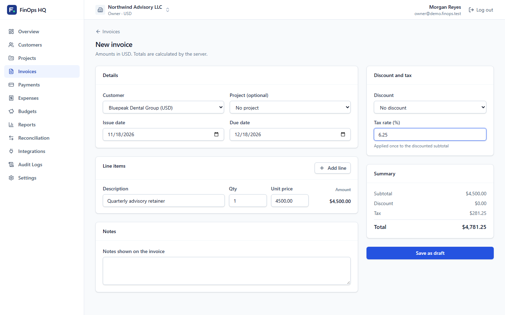 |
| 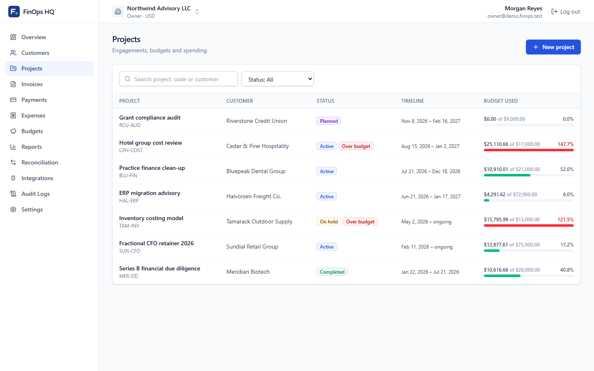 | 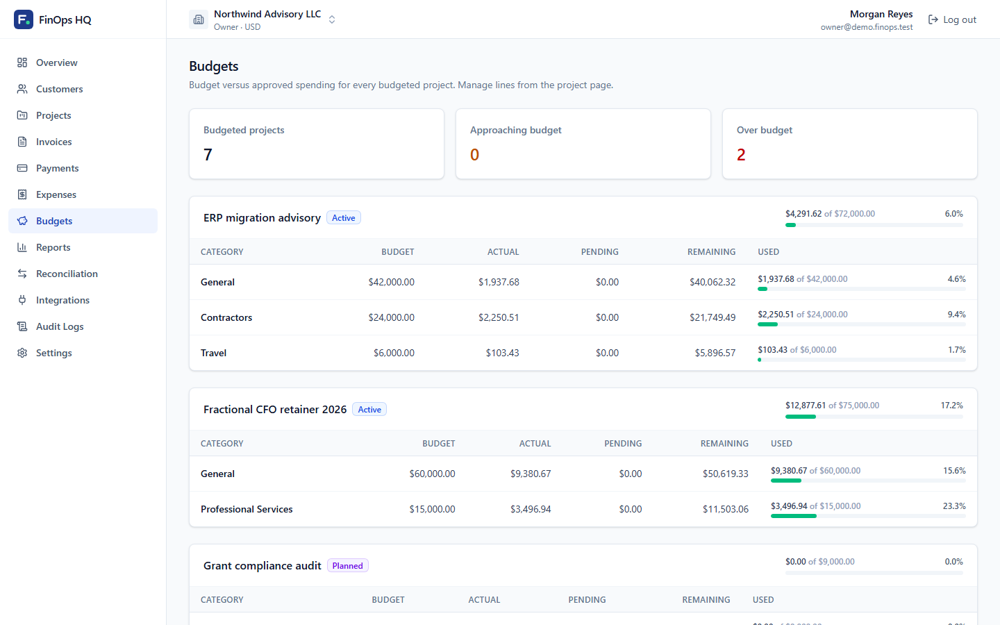 |
| 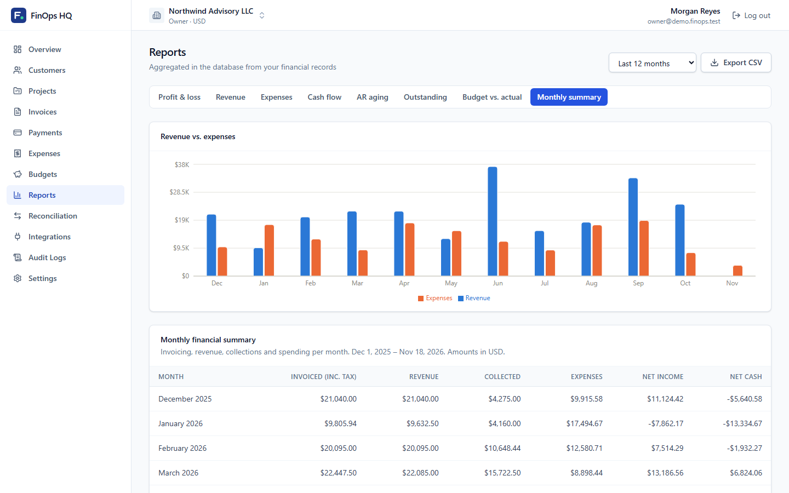 | 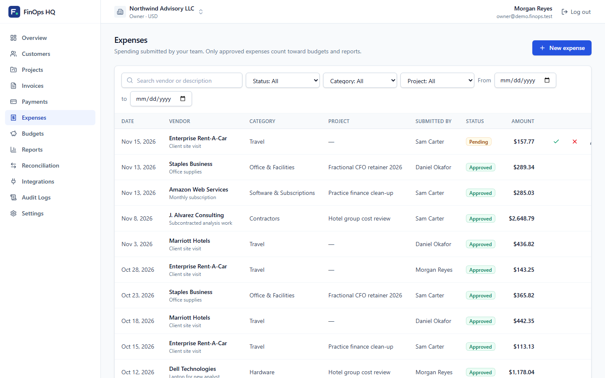 |
| 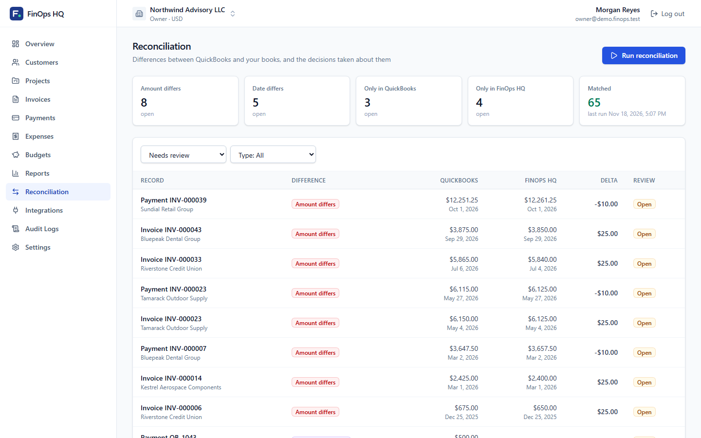 | 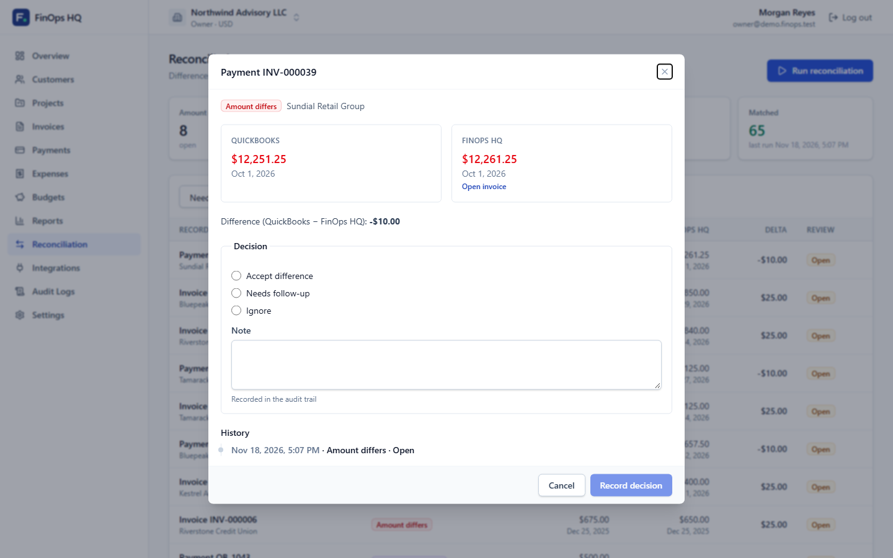 |
| 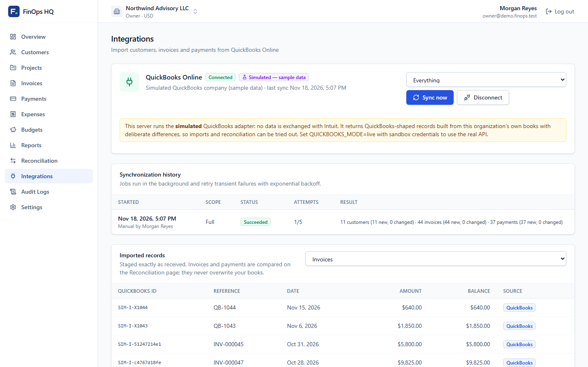 | 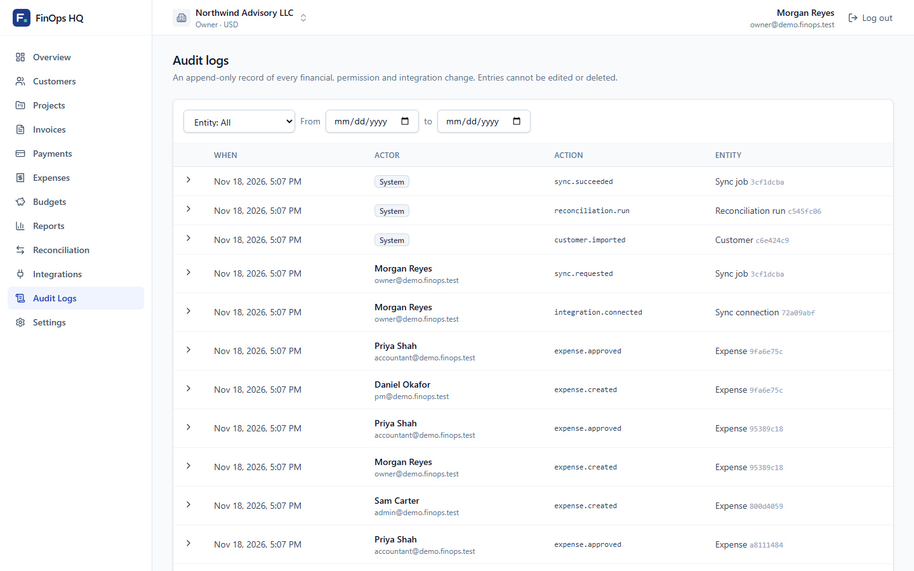 |

## Known limitations

- Live QuickBooks mode has not been tested against a real sandbox (see above).
- No currency conversion. Dashboards and reports show the organization's base currency and say how many records in other currencies they left out.
- Tax is a single rate per invoice. Imported QuickBooks invoices keep the tax-inclusive total QuickBooks reports.
- The cash ledger is single-entry (receipts, reversals and approved expenses), not a full double-entry general ledger.
- No outgoing email: "Mark as sent" records that an invoice was issued; it does not deliver it.
- The login rate limiter is in memory, so it applies per API instance.
